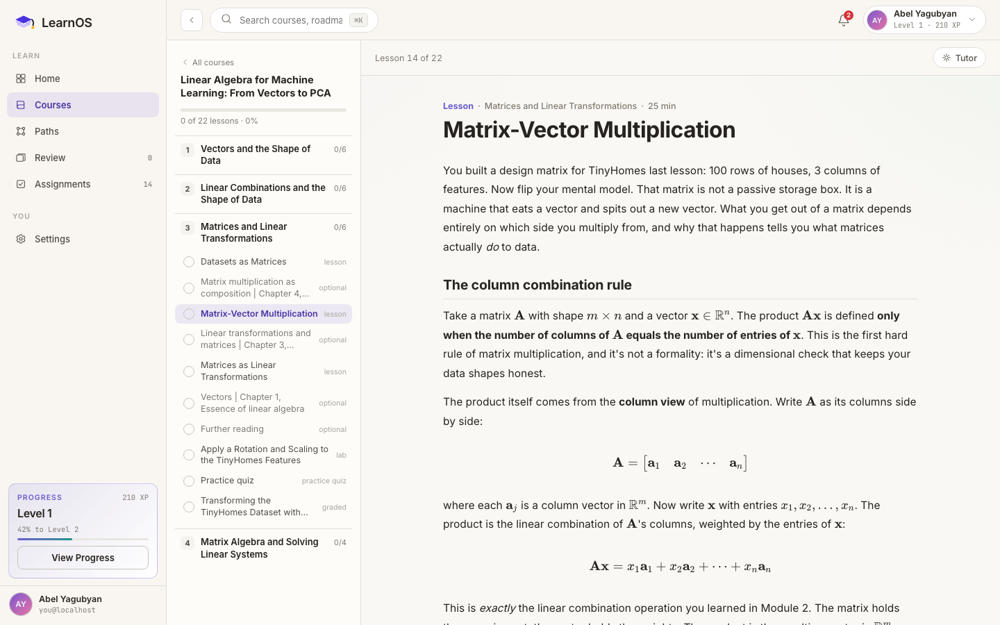
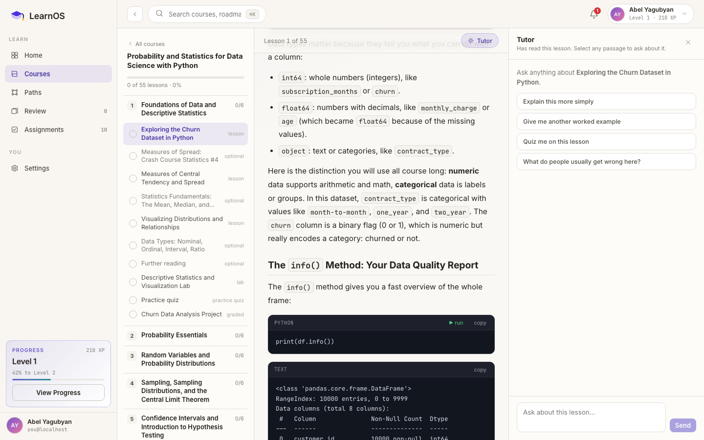
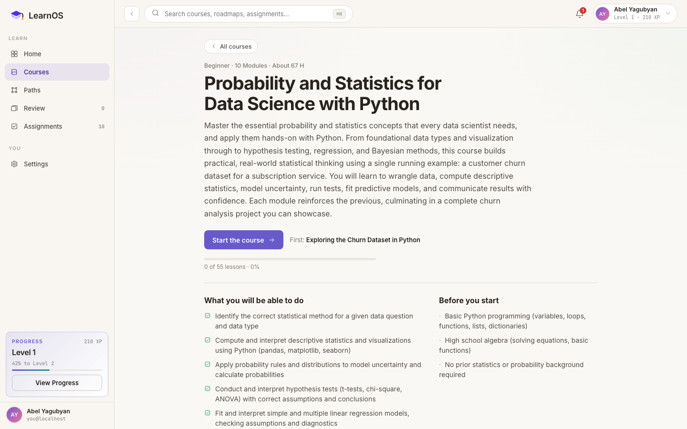

<p align="center">
  <h1 align="center">🎓 LearnOS</h1>
  <p align="center"><strong>The Open-Source AI University</strong></p>
  <p align="center">
    What if Coursera was rebuilt from scratch, with AI agents instead of pre-recorded lectures?
  </p>
</p>

<p align="center">
  <a href="https://github.com/Abelo9996/LearnOS/stargazers"></a>
  <a href="https://github.com/Abelo9996/LearnOS/network/members"></a>
  <a href="https://github.com/Abelo9996/LearnOS/blob/main/LICENSE"></a>
  <a href="https://github.com/Abelo9996/LearnOS/issues"></a>
</p>

<p align="center">
  
  
  
  
  
  
</p>

---

> **Education shouldn't be locked behind logins, paywalls, or a single vendor.**
>
> LearnOS is an **AI university** you run yourself. Name any subject and it writes you a real course: lessons planned in order, worked examples, practice with solutions, labs that check your code, quizzes checked by an independent examiner, and a tutor that has read the lesson you are on. Run it on your **Claude plan** (through Claude Code) or any model on **OpenRouter**. No accounts, no paywall, no lock-in.

---

## 📸 Screenshots

<p align="center">
  
  <br><em>A generated lesson: course outline on the left, LaTeX, runnable code, worked examples, practice with folded solutions</em>
</p>

<p align="center">
  
  <br><em>The tutor sits beside the lesson it has read; select any passage to ask about it</em>
</p>

<p align="center">
  
  <br><em>A course: what you will be able to do, what you need first, and one button to the next lesson</em>
</p>

---

## 🌍 The Problem

Online education is broken:

- 💸 **Expensive**, Coursera, edX, and Udacity charge per course, per certificate, per degree
- 📹 **Static**, Pre-recorded lectures from 2019 teaching a 2026 world
- 🧱 **One-size-fits-all**, Same content whether you're a beginner or an expert
- 🏝️ **Isolated**, You learn alone, drop out alone (completion rates: ~5-15%)

## 🚀 The Vision

LearnOS is an **AI-native university platform** where:

| Traditional Platforms | LearnOS |
|---|---|
| Pre-recorded lectures, the same for everyone | Courses written for your goal and level, on any subject |
| Questions go to a forum, answered days later | A tutor beside every lesson that has read it |
| Content nobody checks after it ships | Every lesson reviewed, every example run, every quiz answer checked, before you see it |
| Locked to one vendor | Your Claude plan, or any model on OpenRouter |
| Your progress lives on their servers | Everything stays on your machine |

Read the full [VISION.md](VISION.md) for where this is headed.

### 🤖 Agentic Architecture

LearnOS isn't "a platform with an AI chatbot." It's a **system of specialized AI agents** that collaborate to deliver a complete university experience. Every agent is a real module under [`ai/agents/`](ai/agents):

| Agent | Role |
|---|---|
| 🗺️ **Curriculum Agent** | Designs personalized learning roadmaps from your goals |
| ✍️ **Course writer** | Writes each lesson in order, told what came before, and revises it against review and code runs |
| 🔎 **Reviewer** | Reads every lesson like a subject expert and answers every quiz question without the key |
| 🧑‍🏫 **Tutor** | Sits beside the lesson you are reading, knows it and what you got wrong |
| 📝 **Assessment Agent** | Writes quizzes, labs and graded work from the lessons, and grades submissions against rubrics |
| 🔍 **Research Agent** | Pulls in supporting resources from the open web |
| 📊 **Analytics Agent** | Tracks learning patterns and surfaces habit insights |
| 🎯 **Profiling Agent** | Models your level, style, and goals during onboarding |

All agents run through a single LLM layer ([`ai/llm.js`](ai/llm.js)) with two providers: your **Claude plan through Claude Code** ([`ai/providers/claudeCode.js`](ai/providers/claudeCode.js), no API key, no per-token bill) or **[OpenRouter](https://openrouter.ai)**, where one key unlocks every major model. Models are routed per agent, so you can, for example, write with a fast model and review with a strong one. Every call is metered.

## ✨ What you get

- 📚 **Courses that teach.** Every lesson opens with a concrete question, builds intuition before formalism, works a full example, names the common mistake, and ends with practice problems whose solutions stay folded until you have tried.
- 🧑‍🏫 **A tutor that has read the lesson.** Open it beside any lesson, or select a passage and ask about exactly that. It knows the course, your level and what you got wrong in the quiz, and gives hints before answers.
- 🧪 **Labs that check your work.** Code runs on your machine against tests; the tests themselves were proven against a reference solution before the course reached you.
- ✅ **Quizzes, then graded work.** Practice quizzes with every answer explained, graded assignments with rubrics, and spaced review of what you missed.
- 🔑 **Your Claude plan or any model.** Use your Claude Pro or Max plan through Claude Code (no API key, nothing extra to pay), or one OpenRouter key for any model, set per agent.
- 🤝 **Courses are files.** Export a course as a single `.learnos.json`, send it, import it.
- 💾 **Yours.** Runs on your computer, stores everything in one SQLite file, no account and no telemetry.

## 🔬 How a course is made

A course is not one big prompt. [`ai/agents/courseBuilder.js`](ai/agents/courseBuilder.js) runs a pipeline where every step is checked by something other than the model that wrote it:

1. **Plan.** The syllabus assigns every lesson its objectives and the concepts it introduces, each concept exactly once across the course, plus one notation and one running example the course keeps extending.
2. **Write, in order.** Each lesson is written alone and told what earlier lessons covered and how the previous one ended, so lessons build instead of repeating.
3. **Run the code.** Every Python and JavaScript example is executed, notebook style. Failures go back to the writer with the real traceback.
4. **Review.** A reviewer agent reads each lesson like a subject expert (accuracy, notation, skipped steps, filler) and the lesson is revised against its findings.
5. **Assess what was taught.** Quizzes, labs and graded work are written from the finished lessons. An independent examiner answers every quiz question without the key, and disputed questions are dropped. Lab tests take their expected values from running the reference solution, and a lab whose starter already passes is rejected.
6. **Cite what exists.** Further reading is checked to load and to be what it claims to be.

Each build stores a report of revisions, review findings and code runs. A build that leaves modules empty says so, and **Finish building** completes them with the same pipeline.

## 🏗️ Quick Start

### Prerequisites

- **Node.js 22.13 or newer** (SQLite is built in, nothing native to compile)
- A model: either **[Claude Code](https://claude.com/claude-code)** signed in with your Claude plan, or an **[OpenRouter key](https://openrouter.ai/keys)**. You choose in the app.
- Optional: Python 3 for Python labs and examples (numpy and pandas recommended)

### Run it

```bash
git clone https://github.com/Abelo9996/LearnOS.git
cd LearnOS
npm install
npm start
```

Open **http://localhost:3001**. The first `npm start` builds the app; after that it starts in a second. There is no login: LearnOS runs as you, on your machine, listening on localhost only (set `HOST=0.0.0.0` to open it to your network).

Onboarding asks how to connect a model. If Claude Code is installed and signed in, one click uses your Claude plan; otherwise paste an OpenRouter key. You can change this any time in **Settings → API keys**, per agent or for all of them.

### Develop

```bash
npm run dev    # API on :3001 (restarts on change) + Vite with hot reload on :3000
npm test
```

### Docker (with the Judge0 code sandbox)

```bash
OPENROUTER_API_KEY=sk-or-... docker compose up -d
```

Open **http://localhost:3210**. This adds [Judge0](https://github.com/judge0/judge0), so labs run in sandboxed containers across many languages. Judge0 needs privileged containers and cgroups; it runs best on a Linux host.

## 🏛️ Architecture

Single Node service: Express serves both the REST API and the built React SPA.

```
LearnOS/
├── server.js             # Express 5 entry point, API + static SPA
├── routes/               # REST endpoints (courses, roadmaps, sessions, …)
├── middleware/           # local-user resolver, logger, url-safety (SSRF guard)
├── db/                   # node:sqlite (sqlite.js), schema.sql, database.js
├── ai/
│   ├── llm.js            # provider-agnostic LLM layer (Claude) + metering
│   ├── jobs.js           # async AI job runner
│   ├── schemas.js        # structured-output schemas
│   └── agents/           # curriculum, assessment, research, analytics, profiling
├── src/                  # React 18 frontend (Vite)
│   ├── screens/          # Landing, Auth, Dashboard, Courses, Roadmap, Session, …
│   └── ...
├── uploads/              # user uploads (avatars, etc.)
├── tests/                # Vitest suite
└── docs/                 # architecture, specs, status
```

Frontend talks to the backend via a `/api` proxy in dev ([`vite.config.js`](vite.config.js)) and same-origin in production.

## 🤝 Sharing courses

A course you generate is not trapped in your install. **Courses → Import or export**
writes the whole thing (modules, lessons, labs, the question bank) to a single
`.learnos.json` file. Anyone with that file gets the entire course by dropping it into
their own LearnOS. No server, no account, no network involved. Nothing imported is
trusted: links are re-checked, and imported questions arrive unverified.

## 🔒 Security

LearnOS is meant to be self-hosted for your own use, so it ships without accounts by design. It still keeps real hardening, an SSRF guard on outbound fetches, magic-byte validation on uploads, Helmet headers, encrypted-at-rest API keys, CORS locked to `APP_URL` in production, and rate limiting. See [SECURITY.md](SECURITY.md) to report a vulnerability.

## 🤝 Contributing

LearnOS is **open-source because education should be free.** We welcome contributions of all kinds, code, agents, courses, and docs. See [CONTRIBUTING.md](CONTRIBUTING.md) and look for issues labeled `good first issue`.

## 📄 License

[MIT](LICENSE), because knowledge should be free.

---

<p align="center">
  <strong>⭐ Star this repo if you believe education should be free and AI-native.</strong>
  <br>
  <sub>Built with conviction that the next university won't have a campus, it'll have a GitHub repo.</sub>
</p>
